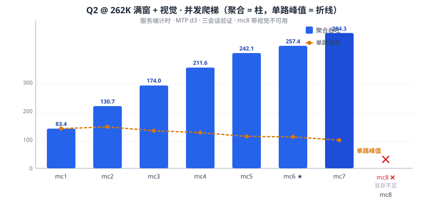
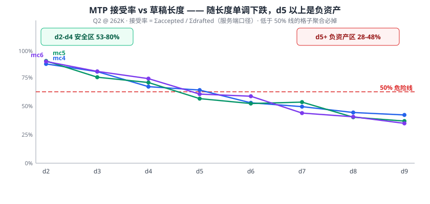
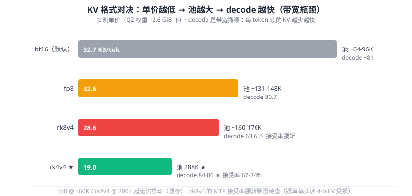
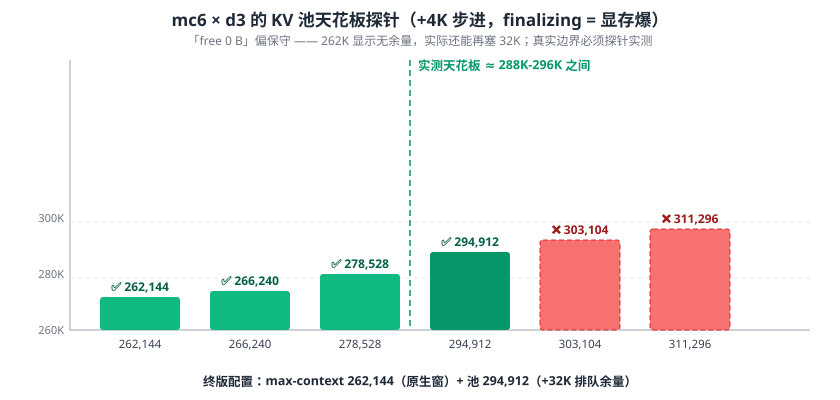
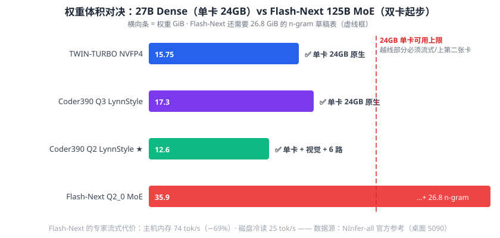

# Qwen3.8 · RTX 5090 Laptop 24GB Limit Log

**The complete showdown record for the Qwen3.8 family on this 24GB laptop card — 27B Dense with dual engine routes, 3-way concurrency × 262K full window, 192-195 tok/s short-par, every number server-side timed**

[中文版 →](./README.md) ｜ [Scripts →](./scripts) ｜ [Raw data →](./data)

       

---

## 🥊 Three Showdowns (overview)

| # | Showdown | Final answer |
|---|---|---|
| **1** | **Concurrency trade-off** (final, 10-12): single-lane speed vs multi-way throughput, Q2 @ 262K full window + vision | **mc3 × d3 + 420K pool**: short-par 192.2-194.8, steady decode 126.5, single 92.7-100.4 |
| **2** | **Deployment route**: native llama.cpp vs NInfer (WSL2 + Docker) | Both work; NInfer +10-25% faster, llama.cpp zero-Docker |
| **3** | **Model architecture**: 27B Dense vs Flash-Next 125B MoE | On 24GB single card → **27B Dense is the only way**; Flash-Next needs 2 GPUs |

---

## 🥊 Showdown 1 · Concurrency trade-off (final): Q2 @ 262K full window + vision

**Smaller model, full window, more lanes** — Q2 LynnStyle (12.6 GiB) is 3.8 GB lighter than Q3, and at a 262K pool all of that becomes concurrency workspace: Q3 cannot even start 2 lanes, **Q2 climbs to 7**.

### Final config & results

| metric | value |
|---|---:|
| Aggregate (3-way short-par, two batches) | **192.2 / 194.8 tok/s** (steady decode 126.5) |
| Single-request decode | 80-83 tok/s |
| Per-lane under load | 59-76 tok/s |
| Context | 262,144 native window (pool 388,032 = mc3 probe ceiling 388K, ~126K queue headroom) |
| MTP acceptance | 48.7-61.0% (d3); 53-65% at d2 |
| Vision | ✅ OCR-grade |

### How to pick the lane count (three sessions, ±5-9% variance)

| lanes | aggregate | per-lane peak | fits |
|---|---:|---:|---|
| mc1 | 83.4 (single) | 83.4 | extreme single task (262K without vision) |
| mc2 | 137.9 | **87** | two-way, near full speed |
| mc4 | 215.3 | 77 | balanced |
| **mc3 ★** | **192.2 / 194.8** (two batches) | 68-74 (steady 46-63) | **final: 3-lane multi-task balance** |
| mc7 | 316.3 | 59 | batch limit (8-way + vision all fail) |

**Three hard rules** (48 + 21 cells, three sessions): ① MTP acceptance falls monotonically with draft length (80% at d2 → 28-37% at d9) — **d5+ is a liability on Q2**; ② each extra lane ≈ +0.5-1 GB workspace — mc7 is the ceiling at 262K+vision; ③ the pool can be oversized to 288K (probe-verified), but a single request stays capped at the native 262,144 window.

| concurrency ladder (aggregate + per-lane peak) | MTP acceptance vs draft length |
|---|---|
|  |  |

### KV format duel: why rk4v4 (FP4)

| KV format duel (rk4v4 wins) | KV pool ceiling (288K at mc6) |
|---|---|
|  |  |

Full log → [`data/q2-262k-tuning-log.md`](./data/q2-262k-tuning-log.md)

---

## 🥊 Showdown 2 · Deployment route: native llama.cpp vs NInfer (WSL2 + Docker)

Same 24GB card, two generations of the daily driver, all numbers from server-side timings:

| metric | TWIN-TURBO + llama.cpp (fallback route) | Coder390 Q2 + NInfer (final route) |
|---|---:|---:|
| single-request decode | 74-78 tok/s | **80-83 tok/s** |
| per-lane peak under load | 73 | **76-100 (long-ctx first lane) / 95 (mc2 × d7)** |
| aggregate (multi-way) | ~115 (np2) | **192-195 (3-way short-par)** |
| context | 160K | **262,144 full native window** |
| deployment | ★ double-click | ★★★ WSL2 + Docker (official image) |
| quality | no published triad | GPQA 87.4% / MMLU 449 / LCB 92 |

- 📊 full data → [`data/ninfer-vs-turbo.md`](./data/ninfer-vs-turbo.md)
- 🔧 deployment log (root-cause chain of three `finalizing target` crashes, KV cost per token, pool probes) → [`docs/ninfer-wsl2-deployment.md`](./docs/ninfer-wsl2-deployment.md)

One-line pick: **want zero-fuss + vision + double-click → llama.cpp; want the fastest, 262K context, real concurrency, and Docker is fine → NInfer.** Both coexist (ports 8082/8083), switch any time.

---

## 🥊 Showdown 3 · Model architecture: 27B Dense (this repo) vs Flash-Next 125B MoE

Same family, two architecture routes: dense 27B vs 125B MoE (512 experts, ~6B active per token). Flash-Next is smarter, but its appetite is **two-GPU-class**.

| | **27B Dense** (this repo) | **Flash-Next 125B MoE** |
|---|---|---|
| Weights | 15.75-17.3 GB | Q2_0 **35.9 GiB** + n-gram table **26.8 GiB** |
| 24GB laptop | ✅ fully on-GPU + vision + 6-way concurrency | ❌ no fit; experts stream from host RAM or disk |
| Desktop 5090 short-answer decode | 236 tok/s (DFlash2, official ref) | 136 tok/s (experts on GPU, **needs 2 cards**) |
| Experts in host RAM | — | 74 tok/s (**−69%**) |
| Experts cold from disk | — | 25 tok/s (not interactive) |
| Quality | Coder390: GPQA 87.4% / MMLU 449 / LCB 92 | Q2_0 (2×5090): **AIME 93.3%** / GPQA-D 86.4% |
| Positioning | best single-card value | math/reasoning specialist for multi-GPU rigs |

**Verdict**: under a 24GB constraint, 27B Dense is the only route that keeps weights + KV + vision + multi-way concurrency all on one card. Flash-Next's 6B-active MoE does top the math benchmarks (AIME 93.3%), but that edge is paid for with a second GPU. Details → [`data/dense-vs-flashnext.md`](./data/dense-vs-flashnext.md)



---

## 🏆 Current Champions (two routes side by side)

### 🅝 Route N: Coder390 Q2 + NInfer (final since 2026-10-12 · daily default · LAN-capable)

Double-click **`scripts/start-ninfer-lan.bat`** (auto-starts Docker → launches the container → health check → prints LAN URLs). Equivalent command:

```powershell
docker run -d --gpus all -p 8083:8080 --ulimit memlock=-1 --name ninfer-coder390 -v "D:\models\ninfer:/models" -v ninfer-cache:/cache ghcr.io/iamwavecut/ninfer-all:latest serve /models/Qwen3.8-27B-Coder390-EfficientThink-Q2LynnStyle-Q4MTP.ninfer --model-id qwen3.8-27b-coder390-q2-q4mtp --max-context 262144 --kv-capacity 420032 --kv-dtype rk4v4 --max-concurrency 3 --spec mtp --draft-tokens 3 --vision --default-reasoning-effort xhigh
```

| **2-way × 262K window + 420K pool** | short-par **147.4 mean** (batches 124.6-169.7) | steady decode **119.8** | single **106.5** | LAN `:8083` |
|---|---|---|---|---|

> Endpoint: `http://<this-PC-IP>:8083/v1/chat/completions` · model `qwen3.8-27b-coder390-q2-q4mtp` · stop: `docker rm -f ninfer-coder390`

### 🅣 Route T: TWIN-TURBO + llama.cpp (former single-card king · zero-Docker fallback)


**One-line launch** (PowerShell; close the window to stop):

```powershell
& "D:\llama-upstream-b11223\llama-server.exe" -m "D:\models\esatapedico\Qwen3.8-27B-TWIN-TURBO-Fable-Cold-Fusion-709-L-Uncensored-NVFP4-MID-HIGH.gguf" --mmproj "D:\models\Qwen3.8-27B-quant-test\mmproj-Q8_0.gguf" -ngl 99 -fa on -fit off -c 163840 -np 1 --ctx-checkpoints 4 --load-mode none --jinja --cache-type-k q8_0 --cache-type-v q8_0 --spec-type draft-mtp --spec-draft-n-max 3 --reasoning-effort xhigh --temp 1.0 --top-p 0.95 --top-k 20 --min-p 0.0 --host 127.0.0.1 --port 8082
```

Route T spec sheet: **74-78 tok/s** decode (~1.8× from MTP) · 160K stable context · vision 3.9 s/image · thinking −93% (fixed in weights). Deep tuning record: [data/tturbo-adoption.md](data/tturbo-adoption.md) and the archive below.

> ⚠️ Route T deliberately skips `--reasoning-budget` / `--chat-template-file`: the model ships its own 10-mode system; old runtime patches conflict with it.
>
> 📦 Three downloads: [TWIN-TURBO NVFP4 MID-HIGH](https://huggingface.co/esatapedico/Qwen3.8-27B-TWIN-TURBO-Fable-Cold-Fusion-709-L-Uncensored-NVFP4-GGUF) (15.75 GB) · [mmproj](https://huggingface.co/Qwen/Qwen3.8-27B) (self-quantize to Q8_0) · [llama.cpp b11223+ Windows CUDA](https://github.com/ggml-org/llama.cpp/releases).

---

## 🎯 10-second decision

| scenario | pick |
| --- | --- |
| daily use / LAN multi-client | **double-click `启动本地大模型-内网8083.bat`** (NInfer Q2 mc2 × d4) ✅ |
| batch / multi-agent parallel | NInfer **mc7 × d3** (aggregate 316.3, see Showdown 1) |
| single-task, extreme context | NInfer mc1 @ 262K (no vision); 192K with vision |
| two-way, each lane fast | mc2 × d2 (87/lane, 80.1% acceptance) |
| zero-Docker, double-click | Route T: TWIN-TURBO one-liner (8082) |
| ingest 260K tokens | Q2 262K native ✅ (Route T: q4_0 KV fallback, see archive) |
| can't stop thinking | Coder390 / TWIN-TURBO — **both fixed at model level** |

---

## 🔁 Reproduce

```powershell
# ── Route N (NInfer · default) ──
# 1. WSL2 + Docker Desktop + ghcr.io/iamwavecut/ninfer-all image (see docs/ninfer-wsl2-deployment.md)
# 2. model: nerkyor Q2LynnStyle-Q4MTP.ninfer (ModelScope / hf-mirror)
# 3. launch
double-click start-ninfer-lan.bat        # or scripts/start-ninfer-lan.bat
# 4. verify
curl http://127.0.0.1:8083/health        # {"status":"ok"}

# ── Route T (llama.cpp · fallback) ──
.\scripts\start-twin-turbo-daily.ps1     # verify curl http://127.0.0.1:8082/health
```

**Acceptance baselines**: Route N single 106.5 tok/s, 2-way short-par 147.4 mean; Route T 74-78 tok/s (server-timed; ±10% from MTP acceptance randomness).

**Measurement discipline** (how every number here was produced):
1. Read **server-side timings** only (`timings` / `/stats`) — never client-side deltas
2. A single reading is noise → conclusions require **re-test consistency**; aggregate calls need two batches
3. Cross-session comparisons are unreliable (±10-31% thermal/clock variance) → trust within-session rankings only
4. "free 0 B" is conservative → **real boundaries must be probe-tested**

**Tooling**: [`scripts/bench-one.py`](scripts/bench-one.py) · [`scripts/bench-par.py`](scripts/bench-par.py) (concurrency + MTP acceptance) · [`scripts/matrix-round9.sh`](scripts/matrix-round9.sh) (48-cell auto-matrix) · [`scripts/start-ninfer-lan.bat`](scripts/start-ninfer-lan.bat) (NInfer launcher) · Route T: [`scripts/bench-parallel.py`](scripts/bench-parallel.py) · [`scripts/start-tt-bench.ps1`](scripts/start-tt-bench.ps1)

---

## 🗄️ Archive: rejected approaches (each with data)

<details>
<summary><b>❌ DFlash2 drafter (2026-09-28) — 4% acceptance on the finetune</b></summary>
Official DFlash2 for Qwen3.8-27B exists ([z-lab GGUF](https://huggingface.co/z-lab/Qwen3.8-27B-DFlash2-GGUF); llama.cpp PR [#27342](https://github.com/ggml-org/llama.cpp/pull/27342)). Tested: Q4_K_M draft, n-max 7, 160K → **25.2 tok/s (−67%), draft acceptance 4%** (86/2,059). The drafter was trained on official Qwen3.8-27B and cannot predict this heavily re-tuned finetune; built-in MTP uses the finetune's own nextn heads. Worth testing only against the official model.
</details>

<details>
<summary><b>❌ NVFP4-MTP-LOW (rounds 1–8 daily driver) — superseded by TWIN-TURBO</b></summary>
Speed dual-winner of the 3-way quant duel (79.6 tok/s / 200K) but lower head precision (Q5_0/IQ4_XS vs all-Q8_0) and no model-level thinking fix. Decision record: [data/tturbo-adoption.md](data/tturbo-adoption.md). The 262K + q4_0 KV fallback config survives (see decision table).
</details>

<details>
<summary><b>❌ 192K+ context (Route T) — VRAM spill, −25%</b></summary>
184K −12%, 192K −25%, 224K same. 168–176K is bimodal. (Under the smaller NVFP4-LOW weights, 192K used to work — the 15.75 GB TWIN-TURBO weights move the cliff.) **NInfer + Q2 has broken this limit: 262K full window, no cliff (rk4v4 KV 19KB/token vs q8_0 26KB).**
</details>

<details>
<summary><b>❌ Runtime thinking patches — conflict with the model's own mode system</b></summary>
TWIN-TURBO trains overthinking away (−93%); stacking budget+template patches made it slower. Historical fixes (still valid for un-finetuned models): [docs/xhigh-overthinking-fix.md](docs/xhigh-overthinking-fix.md), [docs/reasoning-guide.md](docs/reasoning-guide.md)
</details>

<details>
<summary><b>❌ Rejected during the 53→1 quant funnel (IQ3_S / UD-Q4_K_S / SSMFIX / iMatrix …)</b></summary>
Funnel: <a href="#-10-round-log">round log below</a> · iMatrix hybrid (−27% speed): [data/round2-new-results.md](data/round2-new-results.md) · YaRN 1M (4–5 tok/s) and the 262K hard cap: [docs/context-limits-and-yarn.md](docs/context-limits-and-yarn.md)
</details>

<details>
<summary><b>❌ KV format rk8v4 (NInfer route) — 25% slower, MTP acceptance halved</b></summary>
Four KV formats measured (Q2 @ 262K): rk4v4 19KB/tok → **84-86 tok/s, acceptance 67-74%**; fp8 32.6KB → 80.7; rk8v4 28.6KB → 63.6 with acceptance halved to 44%; bf16 52.7KB caps the pool at ~64-96K. Verdict: **FP4 (rk4v4) is faster, cheaper and stable**; needle recall passes on all three. Details: [data/q2-262k-tuning-log.md](data/q2-262k-tuning-log.md) §4.
</details>

## 📜 Tuning log

| round | theme | takeaway |
|---|---|---|
| 1 | quant selection (53 → 1) | NVFP4-LOW wins (speed dual-crown) |
| 2 | KV + MTP tuning | MTP n-max 3 (+40%) |
| 3 | thinking control | xhigh fix: budget + template injection |
| 4 | self-built engine | CUDA 13.3 pairing: prefill +13%, upstream bug fixed ([#28790](https://github.com/ggml-org/llama.cpp/issues/28790)) |
| 5 | context correction | `-np 1` frees VRAM, 150K → 180K |
| 6 | exhaustive re-check | 40+ params swept |
| 7 | context truth | q4_0 KV unlocks 256K · silent cap & YaRN reality |
| 8 | model switch | **TWIN-TURBO MID-HIGH promoted**: −93% thinking, all-Q8_0, patches retired |
| 9 | engine refresh (09-28) | official b11146/b11223 CUDA 13.4: CUDA graphs for MTP draft — same peak, **higher floor** |
| 10 | final tuning (09-28) | MTP depth re-validated · DFlash2 rejected · dual-slot +50% · context cliff mapped: 160K final |
| 11 | engine switch (10-11) | **NInfer-all joins** (WSL2 + Docker): 262K full window, mc1-7 lanes, resident vision, `finalizing` failure chain fully mapped |
| 12 | concurrency final (10-12) | **Coder390 Q2 promoted**: 3.8 GB lighter buys 6 lanes · 48+21-cell matrices · KV duel (rk4v4 wins) · pool ceiling 288K · acceptance rules proven |

---

## ❓ FAQ

**Q: Is the 262K context input or output?**
A: **Shared.** A request's hard cap = max-context covering prompt + generated tokens. Output is flexible, bounded by EOS / the `max_tokens` parameter / the remaining window.

**Q: How much quality does Q2 lose at BPW 3.89?**
A: Official triads: GPQA 177 (parity with FP8) / MMLU 433 (−16, breadth) / LCB 90 (parity). 65K-deep needle recall is verbatim. For knowledge breadth use Q3 (but only 1-2 lanes at 262K).

**Q: Why is mc7 the concurrency ceiling?**
A: Each lane costs 0.5-1 GB of workspace (buffers + draft KV + state); mc8 with vision always exceeds VRAM; mc9 is an engine hard limit (1..8).

**Q: Why doesn't Route T open 256K directly?**
A: llama.cpp + q8_0 KV (26KB/token) spills at 192K (−25%); 160K is its stable value. NInfer + rk4v4 (19KB/token) + Q2 weights have broken that limit: 262K full window, no cliff.

**Q: Does quantized KV lose quality?**
A: Near-lossless across the board. Recall tests pass on both routes (Route T 12K/150K depth; Route N 65K needle verbatim).

**Q: Why not vLLM / SGLang?**
A: No native Windows support (would nest inside WSL2), and NInfer's shared-pool concurrency measured higher (3-way 192-195 tok/s). llama.cpp remains the zero-Docker control route.

**Q: How much faster on a desktop 5090?**
A: prefill 2–3×, decode 1.5–2× (575W vs 145W). Capacity conclusions transfer as a method — re-measure for your weights' size.

**Q: 16GB card?**
A: Route T: smaller tier + q8_0 KV + ~96K ctx. NInfer route: needs an even smaller quant tier — concurrency only makes sense on bigger cards.

**Q: Multiple instances?**
A: Two 27B instances don't fit. NInfer's in-container mc3 concurrency is the answer (192-195 tok/s); Route T uses `-np 2`.

**Q: Image input?**
A: Both routes are native VLMs. Route N: vision inside the Q2 package (`--vision`, OCR-grade tested); Route T: `--mmproj` (self-quantized Q8_0 = 600 MB). Vision VRAM counts against the concurrency ceiling on both.

---

## 🔧 Troubleshooting

### NInfer route

| symptom | cause & fix |
|---|---|
| `startup failed \| finalizing target` (ms-scale) | KV pool + workspace exceed VRAM. **Set `--kv-capacity` explicitly** (`auto` is unreliable), lower lanes or pool; the default KV is bf16 (52.7KB/token) — always fatal at 262K |
| mc8 / high lanes won't start | 0.5-1 GB workspace per lane. Lower lanes or pool ([data/q2-262k-tuning-log.md](data/q2-262k-tuning-log.md) §6) |
| mc9 exits instantly | engine hard limit `--max-concurrency 1..8` |
| Docker engine stuck "verifying" | Desktop's auth enforcer times out against hub.docker.com (~30s+), then releases. Cold-start only; permanent fix = docker-ce inside WSL2 |
| mc7 × d8/d9 won't start | **long drafts also consume workspace** — drop draft length first at high lanes |
| slow first start (51s route calibration) | device profile lives in the /cache volume; deleting it re-calibrates |

### Route T (llama.cpp)

| symptom | cause & fix |
|---|---|
| exits at start, empty log | arg incompatibility. `--no-mmap` was removed; use `--load-mode none` |
| `failed to allocate buffer for kv cache` | ctx beyond VRAM. lower `-c` |
| same config, 20%+ speed swings | knife-edge VRAM saturation. drop to a ctx tier with headroom |
| garbled output | request body not UTF-8 (write JSON file + `curl --data-binary @file`) |

---

## 📚 Full data & docs index

### current routes (2026-10-11 ~ 10-12)

| file | content |
|---|---|
| [data/ninfer-vs-turbo.md](data/ninfer-vs-turbo.md) | **Showdown 2 table**: the two routes head-to-head (final update) |
| [data/q2-262k-tuning-log.md](data/q2-262k-tuning-log.md) | **Showdown 1 log**: Q2 @ 262K tuning (R5-R11, ladders / 48-cell matrix / KV duel / pool probes) |
| [data/dense-vs-flashnext.md](data/dense-vs-flashnext.md) | **Showdown 3**: 27B Dense vs Flash-Next 125B MoE |
| [data/matrix-mc2-7-d2-9-mtp.csv](data/matrix-mc2-7-d2-9-mtp.csv) · [data/matrix-mc2-9-d2-9.csv](data/matrix-mc2-9-d2-9.csv) | raw 48 / 64-cell matrix data |
| [docs/ninfer-wsl2-deployment.md](docs/ninfer-wsl2-deployment.md) | NInfer WSL2 + Docker deployment log |
| [scripts/start-ninfer-lan.bat](scripts/start-ninfer-lan.bat) | **double-click launcher** (LAN 8083) |
| [scripts/matrix-round9.sh](scripts/matrix-round9.sh) · [scripts/bench-par.py](scripts/bench-par.py) · [scripts/bench-one.py](scripts/bench-one.py) | matrix / concurrency / single-shot bench scripts (server-timed) |

### history (Route T llama.cpp era, `data/`)

| file | content |
|---|---|
| [2026-09-28-final-stack-tuning.md](data/2026-09-28-final-stack-tuning.md) | **rounds 9–10**: engine refresh / MTP re-validation / DFlash2 / dual-slot / context cliff |
| [tturbo-adoption.md](data/tturbo-adoption.md) | **round 8**: model-switch decision record |
| [nmax-3-vs-4-comparison.md](data/nmax-3-vs-4-comparison.md) | strict MTP depth comparison |
| [context-scaling-history.md](data/context-scaling-history.md) | full context exploration: 88K → 256K |
| [final-benchmark.md](data/final-benchmark.md) | champion baseline (stability / TTFT / vision) |
| [speed-results.md](data/speed-results.md) ｜ [round2-new-results.md](data/round2-new-results.md) ｜ [round3-6-latest.md](data/round3-6-latest.md) | rounds 1–6 raw data |
| [thermal-stress-12min-100rounds.txt](data/thermal-stress-12min-100rounds.txt) | 12-min thermal raw log |

### docs (`docs/`)

[ninfer-wsl2-deployment.md](docs/ninfer-wsl2-deployment.md) · [context-limits-and-yarn.md](docs/context-limits-and-yarn.md) · [windows-self-build-recipe.md](docs/windows-self-build-recipe.md) · [custom-build-and-mtp-bug.md](docs/custom-build-and-mtp-bug.md) · [reasoning-guide.md](docs/reasoning-guide.md) · [xhigh-overthinking-fix.md](docs/xhigh-overthinking-fix.md) · [vision-setup.md](docs/vision-setup.md) · [ACKNOWLEDGMENTS.md](docs/ACKNOWLEDGMENTS.md)

Historical charts live in [assets/](./assets) (chart1–chart14), generated by [tools/](./tools).

---

## License

| content | license |
|---|---|
| code (`scripts/`, `tools/`) | **MIT** |
| docs & data (README, `docs/`, `data/`, charts) | **CC BY 4.0** |

Third-party: Qwen3.8-27B weights **Apache 2.0** ([Qwen](https://huggingface.co/Qwen/Qwen3.8-27B)) · Coder390 post-training **Apache 2.0** ([nerkyor](https://huggingface.co/nerkyor)) · TWIN-TURBO GGUF per its model card ([esatapedico](https://huggingface.co/esatapedico)) · NInfer-all per its repo ([iamwavecut](https://github.com/iamwavecut/ninfer-all)) · llama.cpp **MIT** · CUDA under NVIDIA EULA. **No model weights are included in this repo.** Full terms: [LICENSE](LICENSE), [docs/ACKNOWLEDGMENTS.md](docs/ACKNOWLEDGMENTS.md).

## Acknowledgments

**Alibaba / Qwen team** (base model, Flash-Next) · **nerkyor** (Coder390 post-training) · **NInfer-all community** (the engine) · **llama.cpp community** (Route T) · **esatapedico** (TWIN-TURBO NVFP4) · **ISTA-DASLab** (quant methods) · every public measurer who blazed the 5090 laptop trail.
